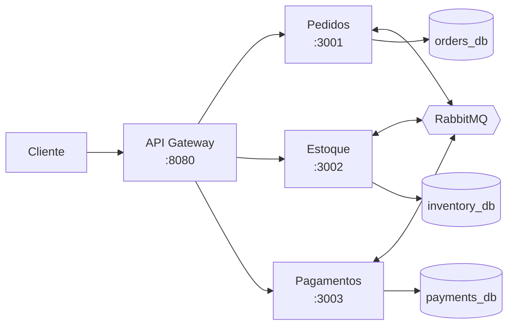

# Pedidos Veloz

**Entrega contínua de uma plataforma de pedidos em microsserviços: do Docker Compose ao Kubernetes com observabilidade e CI/CD**

Plataforma de pedidos da **Loja Veloz** (empresa fictícia), construída como
projeto acadêmico de Cloud e DevOps.

> ### Estado de validação
>
> **Nenhum comando foi executado durante a construção deste projeto.** O
> ambiente de geração não dispôs de terminal funcional. Todo o código está
> validado **por inspeção**; a validação por execução depende de você e está
> listada em [§ Comandos de validação](#comandos-de-validação).
>
> Dois artefatos **precisam ser gerados** antes do primeiro uso, e não foram
> fabricados de propósito: o `package-lock.json` (`npm install`) e as migrations
> do Prisma (`npx prisma migrate dev`).

---

## Contexto

A Loja Veloz cresceu rápido e acumulou: indisponibilidade durante deploys,
dificuldade de escalar sob pico, deploys manuais, ambientes inconsistentes,
baixa rastreabilidade, ausência de observabilidade, configuração dispersa e
credenciais mal tratadas. Uma campanha promocional se aproxima; o prazo é de
quatro semanas.

## Arquitetura



Quatro serviços. O Gateway não acessa banco. **Não há HTTP entre serviços de
backend** — toda comunicação entre domínios é por evento, e a NetworkPolicy do
Kubernetes torna isso uma restrição efetiva de rede.

Diagramas completos em [`docs/architecture.md`](docs/architecture.md) e
[`docs/diagrams/README.md`](docs/diagrams/README.md).

### Fluxo do pedido

```
POST /api/orders → PENDING → order.created
  ├─ estoque OK  → STOCK_RESERVED → pagamento
  │                   ├─ aprovado → CONFIRMED
  │                   └─ recusado → PAYMENT_FAILED → libera estoque
  └─ sem estoque → STOCK_FAILED
```

O `201 Created` significa **aceito**, não confirmado. O desfecho vem de
`GET /api/orders/:id`.

## Tecnologias

| Camada | Escolha |
|---|---|
| Runtime | Node.js 22 LTS, TypeScript 5.6 |
| Monorepo | npm workspaces |
| HTTP | Express 4, Zod, Helmet, express-rate-limit |
| Dados | PostgreSQL 16, Prisma 6 |
| Mensageria | RabbitMQ 3.13 (amqplib) |
| Observabilidade | OpenTelemetry, Prometheus, Grafana, Loki, Alloy, Jaeger |
| Contêineres | Docker, Compose, `node:22-bookworm-slim`, multi-stage |
| Orquestração | Kubernetes, Kustomize, NGINX Ingress, HPA v2 |
| CI/CD | GitHub Actions, GHCR, Trivy |
| IaC | Terraform, AWS (EKS, RDS, VPC) |
| Testes | Jest, Supertest |

## Pré-requisitos

- Node.js 22 (`nvm use` respeita o `.nvmrc`)
- Docker e Docker Compose v2
- Para Kubernetes: `kubectl`, um cluster (kind, minikube ou Docker Desktop) e
  Helm
- Para nuvem: Terraform 1.9+ e conta AWS

## Estrutura

```
loja-veloz/
├── apps/                api-gateway, order-service, inventory-service, payment-service
├── packages/            shared-types, shared-config, observability, messaging
├── database/            script de init do PostgreSQL
├── kubernetes/          base, overlays (dev/staging/prod), helm-values
├── observability/       Prometheus, Grafana, Loki, Alloy, OTel Collector
├── terraform/           módulos (network, eks, database) e ambientes
├── tests/               integração e smoke
├── scripts/             demonstração e seed
├── docs/                arquitetura, ADRs, runbook, relatórios
└── .github/workflows/   ci.yml, images.yml, deploy-staging.yml
```

## Instalação

```bash
npm install          # gera o package-lock.json real — necessário antes de tudo
```

Depois, gere as migrations (uma vez, com o banco no ar):

```bash
docker compose up -d postgres

cd apps/order-service     && npx prisma migrate dev --name init && cd ../..
cd apps/inventory-service && npx prisma migrate dev --name init && cd ../..
cd apps/payment-service   && npx prisma migrate dev --name init && cd ../..
```

Os arquivos gerados em `apps/*/prisma/migrations/` **devem ser versionados**.

## Variáveis de ambiente

```bash
cp .env.example .env                    # Bash
Copy-Item .env.example .env             # PowerShell
```

Grupos principais: PostgreSQL (3 bancos e usuários), RabbitMQ, portas do host,
URLs internas, observabilidade, segurança do Gateway e os recursos acadêmicos de
demonstração. Todos comentados em [`.env.example`](.env.example).

Nenhum valor do repositório é segredo real: são credenciais descartáveis,
válidas apenas dentro da rede do Compose.

## Execução

```bash
docker compose up --build
docker compose ps
```

| Interface | URL | Credencial |
|---|---|---|
| API Gateway | http://localhost:8080 | — |
| Grafana | http://localhost:3000 | `admin` / `admin` |
| Prometheus | http://localhost:9090 | — |
| Jaeger | http://localhost:16686 | — |
| RabbitMQ | http://localhost:15672 | ver `.env` |

PostgreSQL e os três serviços internos **não** são publicados no host.

Migrations e seed rodam automaticamente pelos serviços `*-migrate`.

## Testes

```bash
npm run test                    # unitários (~150 casos)
npm run test:coverage

docker compose -f docker-compose.test.yml up --build -d --wait
npm run test:integration
docker compose -f docker-compose.test.yml down -v

bash tests/smoke/smoke.sh       # smoke
pwsh tests/smoke/smoke.ps1      # Windows sem WSL
```

Detalhes em [`tests/README.md`](tests/README.md).

## Criar e consultar pedidos

```bash
curl -X POST http://localhost:8080/api/orders \
  -H 'content-type: application/json' \
  -d '{"customerId":"CUSTOMER-001","items":[{"sku":"SKU-TECLADO-001","quantity":2,"unitPrice":125.25}]}'

curl http://localhost:8080/api/orders/<orderId>
curl http://localhost:8080/api/orders?page=1&pageSize=10&status=CONFIRMED
curl http://localhost:8080/api/inventory/SKU-TECLADO-001
curl http://localhost:8080/api/payments/<orderId>
```

## Falhas simuladas

Ambos os cenários são **determinísticos** — não há aleatoriedade em lugar
nenhum do projeto.

```bash
bash scripts/create-order.sh                  # CONFIRMED
bash scripts/create-order.sh sem-estoque      # STOCK_FAILED
bash scripts/create-order.sh falha-pagamento  # PAYMENT_FAILED
```

| Cenário | Gatilho | Desligar |
|---|---|---|
| Falha de estoque | `SKU-SEM-ESTOQUE`, saldo 0 no seed | repor via `POST /inventory/restock` |
| Falha de pagamento | `CUSTOMER-PAYMENT-FAIL` | `PAYMENT_SIMULATION_ENABLED=false` |

**São recursos acadêmicos de demonstração, não comportamento de produção.**
Ambos vêm desligados no overlay de produção.

## Observabilidade

**Grafana** (http://localhost:3000) traz o painel "Pedidos Veloz - Visão Geral"
já provisionado: disponibilidade, latência por percentil, fluxo de pedidos e
estado da mensageria.

**Loki** — buscar tudo sobre um pedido:

```logql
{job="docker"} |= "<orderId>"
{job="docker", service="order-service", level="error"} | json
```

**Jaeger** (http://localhost:16686) — o trace atravessa o Gateway, o Serviço de
Pedidos, o banco, o broker e os consumidores. O `traceId` de qualquer linha de
log leva direto ao trace correspondente.

**RabbitMQ** (http://localhost:15672) — filas, taxas e DLQs.

Detalhes em [`observability/README.md`](observability/README.md).

## Kubernetes

```bash
# Validação sem cluster
kubectl kustomize kubernetes/overlays/development
kubectl apply --dry-run=client -k kubernetes/overlays/development

# Deploy local
docker compose build
kind load docker-image loja-veloz/loja-veloz-api-gateway:local   # e os outros três
kubectl apply -k kubernetes/overlays/development

# Escala
kubectl get hpa -n loja-veloz -w
kubectl top pods -n loja-veloz

# Rollout e rollback
kubectl rollout status deployment/order-service -n loja-veloz
kubectl rollout history deployment/order-service -n loja-veloz
kubectl rollout undo deployment/order-service -n loja-veloz
```

**Pré-requisitos que não vêm prontos:** Metrics Server (sem ele o HPA não
escala), NGINX Ingress Controller e um CNI que implemente NetworkPolicy — o
padrão do kind e do Docker Desktop **não implementa**, e as políticas são
silenciosamente ignoradas. Ver [`kubernetes/README.md`](kubernetes/README.md).

**Rollback com migration não é automático.** Reverter o Deployment não desfaz
alteração de schema; o procedimento está no runbook.

## CI/CD

| Workflow | Gatilho | Faz |
|---|---|---|
| `ci.yml` | PR e push | lint, format, typecheck, testes, build, valida Compose, Kustomize e Terraform |
| `images.yml` | main e tags | build em matriz, Trivy **antes** do push, publica no GHCR |
| `deploy-staging.yml` | manual | migrations, apply, rollout, smoke, rollback condicional |

Imagens: `ghcr.io/<USUARIO_GITHUB>/loja-veloz-<serviço>:sha-<commit>`.

**Por que não usar apenas `latest`:** é um ponteiro móvel. Dois deploys "da
latest" em momentos diferentes instalam imagens diferentes — o ambiente deixa
de ser reprodutível e o rollback fica impossível, porque não existe "latest
anterior".

## Terraform

```bash
cd terraform/environments/staging
cp terraform.tfvars.example terraform.tfvars
cp backend.tf.example backend.tf

terraform init
terraform validate      # não precisa de credencial AWS
terraform plan          # precisa de credencial
terraform apply         # CRIA RECURSOS COBRADOS
terraform destroy
```

> **Custo.** EKS, RDS e NAT Gateway são cobrados por hora, ociosos ou não. O
> NAT vem **desligado** por padrão em staging. Nenhum valor em moeda é informado
> aqui — preços variam por região e conta. Use a calculadora oficial da AWS.
>
> **Nada foi aplicado.** Ver [`terraform/README.md`](terraform/README.md).

## Segurança

Implementado: usuário não-root, imagens mínimas, dependências travadas por
lockfile, Trivy, rate limiting, Helmet, CORS por configuração, validação Zod,
limite de body, timeouts, erros sem vazamento, logs com redaction,
ServiceAccounts sem token montado, NetworkPolicies, Pod Security Standards,
segredos fora do Git, permissões mínimas no CI e separação de ambientes.

> **Base64 não é criptografia.** O campo `data` de um Secret do Kubernetes é
> apenas codificação reversível, e Secrets ficam em texto claro no etcd por
> padrão. As proteções reais são RBAC e criptografia em repouso — **nenhuma das
> duas é configurada por este projeto**.

**Riscos residuais altos, declarados:** ausência completa de autenticação nas
APIs, ausência de expiração de reserva de estoque e ausência de trilha de
auditoria confiável. Análise completa em
[`docs/threat-model.md`](docs/threat-model.md).

## Comandos de validação

Execute na ordem. Substitua cada `PENDENTE` pelo resultado observado.

| # | Comando | Resultado esperado | Status |
|---|---|---|---|
| 1 | `npm install` | `package-lock.json` criado | PENDENTE |
| 2 | `npm run lint` | sem erros | PENDENTE |
| 3 | `npm run format:check` | todos os arquivos formatados | PENDENTE |
| 4 | `npm run prisma:generate` | client gerado nos 3 serviços | PENDENTE |
| 5 | `npm run typecheck` | sem erros de tipo | PENDENTE |
| 6 | `npm run test` | todas as suítes passando | PENDENTE |
| 7 | `npm run build` | `dist/` em 8 workspaces | PENDENTE |
| 8 | `docker compose config` | YAML resolvido, sem erro | PENDENTE |
| 9 | `docker compose up --build` | 12 serviços; `*-migrate` com exit 0 | PENDENTE |
| 10 | `docker compose ps` | serviços `healthy` | PENDENTE |
| 11 | `curl localhost:8080/health/live` | `{"status":"ok",...}` | PENDENTE |
| 12 | `curl localhost:8080/health/ready` | `{"status":"ready",...}` | PENDENTE |
| 13 | `bash tests/smoke/smoke.sh` | todas as verificações OK | PENDENTE |
| 14 | `npm run test:integration` | 6 blocos passando | PENDENTE |
| 15 | `kubectl kustomize kubernetes/overlays/development` | YAML renderizado | PENDENTE |
| 16 | `kubectl apply --dry-run=client -k .../development` | recursos validados | PENDENTE |
| 17 | `terraform fmt -check -recursive terraform` | sem diferenças | PENDENTE |
| 18 | `terraform validate` (staging e prod) | configuração válida | PENDENTE |

Nenhum destes foi executado. Ver
[`docs/practical-report.md`](docs/practical-report.md) § 15.

## Limpeza

```bash
docker compose down -v                              # local (apaga dados)
kubectl delete -k kubernetes/overlays/development
cd terraform/environments/staging && terraform destroy
```

`terraform destroy` é o único jeito confiável de parar a cobrança na AWS.

## Limitações

As mais relevantes: pagamento simulado; instância PostgreSQL única no ambiente
local; **ausência de transactional outbox**, com janela residual entre commit e
publicação; entrega "ao menos uma vez", nunca "exatamente uma vez"; sem service
mesh e portanto sem mTLS; **sem autenticação**; sem expiração de reserva;
workloads com estado simplificados no cluster local; sem alta disponibilidade
real do banco; **sem teste de carga** — nenhuma afirmação de desempenho neste
projeto é sustentada por dados medidos; deploy em staging dependente de cluster;
e Terraform não aplicado.

Lista completa com motivo e consequência em
[`docs/limitations-and-roadmap.md`](docs/limitations-and-roadmap.md).

## Melhorias futuras

Prioritárias: OAuth 2.0/OIDC, expiração de reserva, transactional outbox,
External Secrets Operator e teste de carga com k6. Depois: KEDA, Argo CD, Argo
Rollouts, service mesh, RDS por serviço, RabbitMQ gerenciado, SBOM, Cosign,
OPA/Kyverno, backups testados e disaster recovery.

## Documentação

| Documento | Conteúdo |
|---|---|
| [`docs/architecture.md`](docs/architecture.md) | Arquitetura completa, 6 diagramas |
| [`docs/diagrams/README.md`](docs/diagrams/README.md) | Índice dos 9 diagramas |
| [`docs/adr/`](docs/adr/) | 12 decisões arquiteturais |
| [`docs/runbook.md`](docs/runbook.md) | Procedimentos operacionais |
| [`docs/troubleshooting.md`](docs/troubleshooting.md) | 29 problemas catalogados |
| [`docs/threat-model.md`](docs/threat-model.md) | 15 ameaças com risco residual |
| [`docs/case-study.md`](docs/case-study.md) | Online Boutique, verificado na fonte |
| [`docs/theoretical-report.md`](docs/theoretical-report.md) | Relatório teórico |
| [`docs/practical-report.md`](docs/practical-report.md) | Relatório prático |
| [`docs/traceability-matrix.md`](docs/traceability-matrix.md) | Rastreabilidade dos requisitos |
| [`docs/references.md`](docs/references.md) | Referências (ABNT NBR 6023) |
| [`PROJECT_MANIFEST.md`](PROJECT_MANIFEST.md) | Manifesto dos arquivos autorais |

## Referências

Fontes primárias em [`docs/references.md`](docs/references.md). Três estão
verificadas; as demais estão marcadas como
`[REFERÊNCIA PENDENTE DE VERIFICAÇÃO]` — apresentar como conferida uma URL que
não foi aberta seria inventar dado.

---

## Licença

MIT. Projeto acadêmico. **Não use em produção sem, no mínimo, resolver a
ausência de autenticação e a ausência de expiração de reserva de estoque.**
