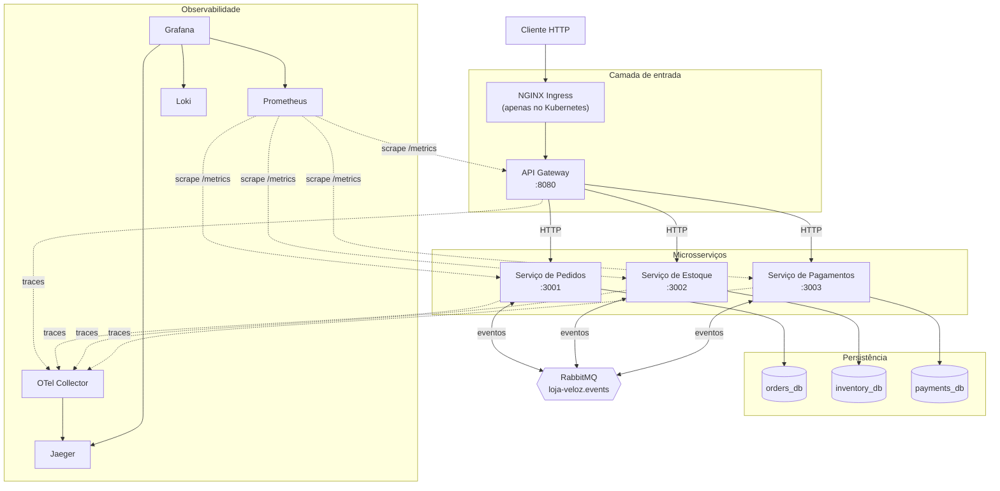
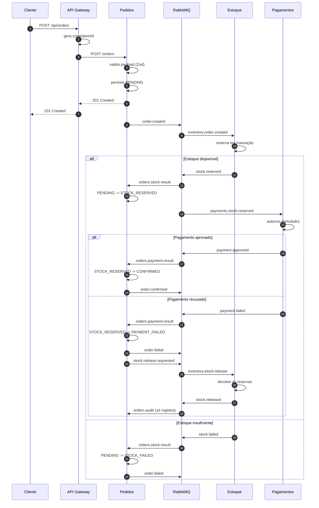
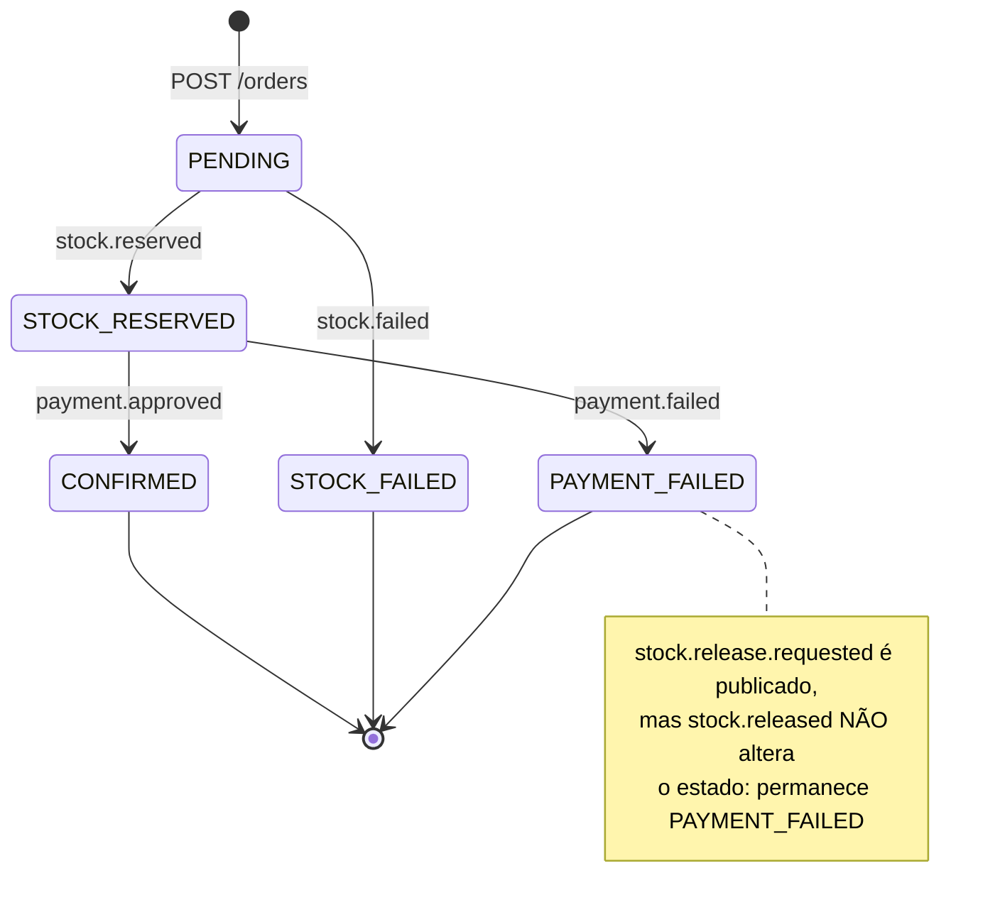
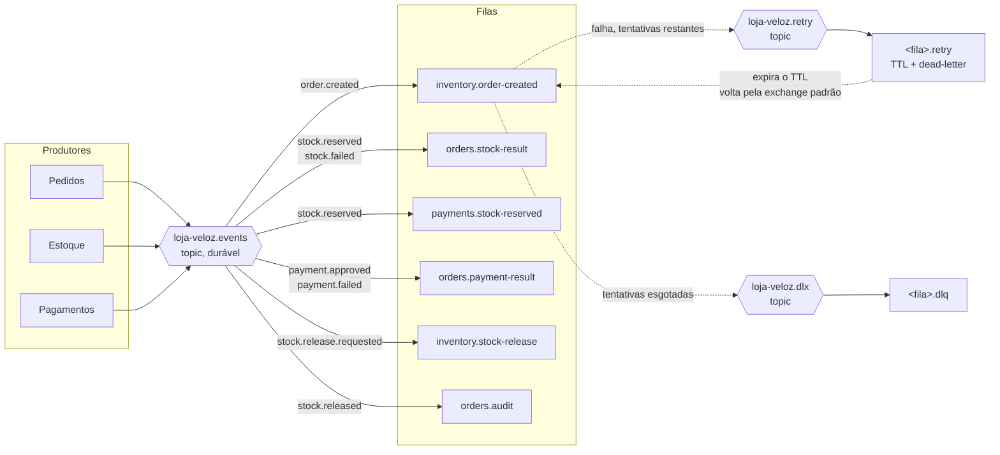
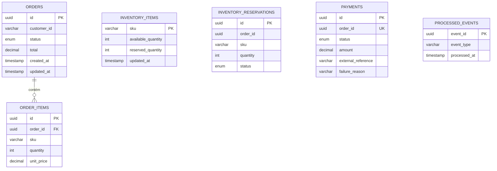
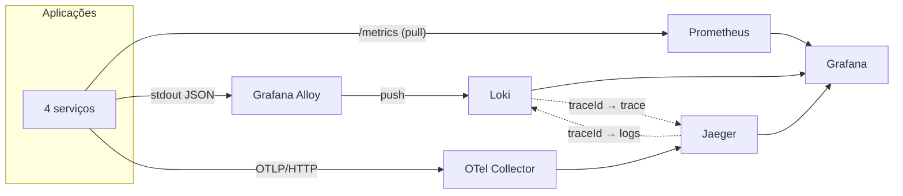

# Arquitetura — Pedidos Veloz

## 1. Problema

A Loja Veloz cresceu rápido e o ambiente atual apresenta indisponibilidade
durante deploys, dificuldade de escalar sob pico, deploys manuais, ambientes
inconsistentes, baixa rastreabilidade de falhas, ausência de observabilidade
centralizada, configuração espalhada, credenciais tratadas de forma inadequada
e dificuldade de reproduzir a infraestrutura.

Uma campanha promocional se aproxima. O prazo é de quatro semanas.

O que o projeto precisa demonstrar: **reduzir o risco de deploy, encurtar o
tempo de entrega, escalar sob demanda e aumentar a confiabilidade** por meio de
automação, governança e telemetria.

## 2. Visão geral



Três observações que o diagrama torna visíveis:

1. **O Gateway não toca em banco.** Ele encaminha, e nada mais.
2. **Não há seta HTTP entre serviços de backend.** Toda comunicação entre
   domínios passa pelo broker. A NetworkPolicy do Kubernetes transforma essa
   decisão de desenho em restrição efetiva de rede.
3. **Cada serviço tem o seu banco.** Nenhuma seta cruza de um serviço para o
   banco de outro.

## 3. Responsabilidades

### API Gateway

Recebe requisições externas, gera ou propaga o `correlationId`, aplica rate
limiting e CORS, encaminha chamadas, padroniza erros, expõe healthchecks e
métricas, propaga o trace context.

**Não faz:** acesso a banco, regra de negócio, decisão sobre pedido.

O Gateway é a única superfície pública. Concentrar CORS, rate limit e
normalização de erro nele evita replicar essas preocupações em três serviços —
e evita a falsa defesa em profundidade de duplicá-las onde a NetworkPolicy já
garante que só o Gateway alcança os backends.

### Serviço de Pedidos

Cria e consulta pedidos, armazena itens, **controla o estado do pedido**,
publica `order.created`, consome resultados de estoque e pagamento, atualiza o
estado final.

É o **único componente autorizado a mudar o estado de um pedido**, e toda
mudança passa por `assertTransition`.

### Serviço de Estoque

Mantém quantidades disponíveis e reservadas, consulta estoque, reserva itens em
transação tudo-ou-nada, libera reservas após falha de pagamento, consome
eventos de pedido, publica resultados.

### Serviço de Pagamentos

Simula a integração de pagamento, registra pagamentos, consome
`stock.reserved`, publica aprovação ou falha, permite consulta por pedido.

Só entra em cena **depois** que o estoque foi reservado. Cobrar antes de
confirmar disponibilidade geraria estorno em todo pedido sem estoque.

## 4. Fluxo do pedido



O `201 Created` chega ao cliente **antes** de o pedido ser processado. Essa é a
consequência central do desenho assíncrono: o cliente sabe que o pedido foi
aceito, não que foi confirmado. Consultar `GET /api/orders/:id` é como se
descobre o desfecho.

## 5. Estados do pedido



Cinco estados, quatro transições válidas, três terminais. Qualquer outra
transição é rejeitada por `assertTransition` e registrada como anomalia.

**Transição inválida não vai para retry.** Um evento fora de ordem ou recebido
após estado terminal produziria o mesmo resultado em toda nova tentativa; ele é
absorvido, registrado em log e contado em
`orders_invalid_transitions_total{from,to}`.

## 6. Topologia do RabbitMQ



**Retry com atraso sem plugin externo.** A fila `<fila>.retry` tem
`messageTtl` e `deadLetterExchange: ""` com `deadLetterRoutingKey` igual ao
nome da fila original. Quando o TTL expira, o broker envia a mensagem para a
exchange padrão, que roteia por nome de fila — devolvendo-a exatamente ao
consumidor que falhou, depois do atraso. Usa apenas recursos nativos do
RabbitMQ.

**Contrato de acknowledgement.** O `ack` só acontece depois de (a)
processamento bem-sucedido ou (b) republicação **confirmada** na fila de retry
ou na DLQ. `nack(requeue: true)` é usado apenas quando nem a republicação
funciona — devolver ao broker é mais seguro que descartar.

**Entrega ao menos uma vez.** O projeto **não promete "exatamente uma vez"**.
A defesa é a tabela `processed_events`, com `event_id` como chave primária,
gravada na mesma transação que aplica o efeito de negócio.

### Envelope dos eventos

```typescript
interface DomainEvent<TPayload> {
  eventId: string; // chave de idempotência
  eventType: string; // idêntico à routing key
  eventVersion: number; // começa em 1
  occurredAt: string; // ISO 8601 com offset
  correlationId: string; // jornada de negócio
  causationId?: string; // eventId que originou este
  producer: string;
  payload: TPayload;
}
```

Nove eventos: `order.created`, `stock.reserved`, `stock.failed`,
`payment.approved`, `payment.failed`, `stock.release.requested`,
`stock.released`, `order.confirmed`, `order.failed`. Cada um com schema Zod,
tipo TypeScript e testes de validação em `packages/shared-types`.

Alteração incompatível exige **nova versão**, nunca mudança silenciosa do
payload. Como os schemas são compartilhados em tempo de compilação, um produtor
que quebre o contrato falha no `npm run build`, e não em produção.

## 7. Modelo de dados



`PROCESSED_EVENTS` existe nos **três** bancos, um por serviço consumidor.
`INVENTORY_RESERVATIONS` tem restrição única em `(order_id, sku)`; `PAYMENTS`
tem restrição única em `order_id` — duas defesas independentes contra
duplicação.

### Isolamento

Uma instância PostgreSQL, três bancos, três usuários. Cada serviço acessa
**apenas** o banco pelo qual responde.

É economia operacional do MVP, não recomendação de arquitetura. O isolamento
que importa — de esquema e credencial — está preservado, e migrar para
instâncias separadas não exige mudar código, só as `DATABASE_URL`.
Detalhamento em `database/README.md`.

## 8. Observabilidade



**`correlationId` e trace context não são a mesma coisa.** O primeiro
identifica a jornada de negócio e sobrevive a saltos assíncronos longos e a
reprocessamento; o segundo identifica uma árvore de spans de execução, com
amostragem. Ambos aparecem em toda linha de log. Detalhamento em
`observability/README.md`.

**Regra de cardinalidade:** `orderId`, `customerId`, `eventId`,
`correlationId` e URLs dinâmicas **nunca** viram label do Prometheus. Cada
combinação distinta cria uma série temporal, e identificadores criariam séries
sem limite. Essa informação vive em logs e traces.

## 9. Ambiente local e Kubernetes

| Aspecto        | Docker Compose             | Kubernetes                           |
| -------------- | -------------------------- | ------------------------------------ |
| Orquestração   | `docker-compose.yml`       | Kustomize, três overlays             |
| Réplicas       | 1 por serviço              | 1 (dev) / 2 (staging) / 3 (prod)     |
| Banco e broker | contêineres locais         | RDS + Amazon MQ (recomendado)        |
| Coleta de logs | Alloy via socket do Docker | Alloy via API do Kubernetes          |
| Rede           | bridge                     | NetworkPolicy com negação por padrão |
| Escala         | manual                     | HPA v2 por CPU                       |

O contexto de build das imagens é **sempre a raiz do monorepo**, porque o build
depende do `package-lock.json` e dos pacotes em `packages/`.

## 10. Deploy

**Rolling Update** com `maxSurge: 1` e `maxUnavailable: 0`: sobe um pod novo,
espera o readiness, e só então derruba um antigo. Sem indisponibilidade, sem
ferramenta além do Kubernetes.

**Canary ponderado não é entregue.** Um Service comum do Kubernetes **não faz
divisão percentual de tráfego** — ele distribui entre os pods que casam com o
selector, e a proporção é o número de pods de cada versão. Dois Deployments
atrás do mesmo Service não são canary. Canary de verdade exige Argo Rollouts,
Flagger, Istio ou annotations de canary do NGINX Ingress. Registrado como
evolução futura.

## 11. Escalabilidade

HPA v2 por CPU, calculado sobre `requests.cpu`. Limites por serviço distintos:
o Gateway escala até 10 réplicas (I/O-bound, sem banco), os serviços com banco
até 8 — porque **o teto real de escala não é CPU, é o `max_connections` do
PostgreSQL**.

CPU é métrica ruim para consumidor de fila: um acúmulo de mensagens não
necessariamente aparece como CPU alta. KEDA, escalando pela profundidade da
fila, é a evolução indicada.

HPA e VPA **não** atuam sobre o mesmo recurso no mesmo Deployment.

## 12. Decisões registradas

As decisões arquiteturais estão em `docs/adr/`, uma por arquivo, com contexto,
alternativas consideradas, consequências positivas e negativas, riscos e
critérios de revisão:

ADR-001 monorepo · ADR-002 microsserviços · ADR-003 RabbitMQ ·
ADR-004 bancos separados · ADR-005 Kubernetes · ADR-006 Rolling Update ·
ADR-007 OpenTelemetry · ADR-008 sem service mesh · ADR-009 GitHub Actions e
GHCR · ADR-010 Terraform e AWS · ADR-011 Kustomize · ADR-012 HPA com CPU

## 13. Limitações

Declaradas em `docs/limitations-and-roadmap.md`. As mais relevantes para
avaliar a arquitetura:

- pagamento simulado
- instância PostgreSQL única no ambiente local
- **ausência de transactional outbox**, com janela residual entre o commit e a
  publicação do evento
- sem service mesh, sem autenticação completa
- RabbitMQ local sem alta disponibilidade
- sem teste de carga: **nenhuma afirmação de desempenho neste projeto é
  sustentada por dados medidos**
