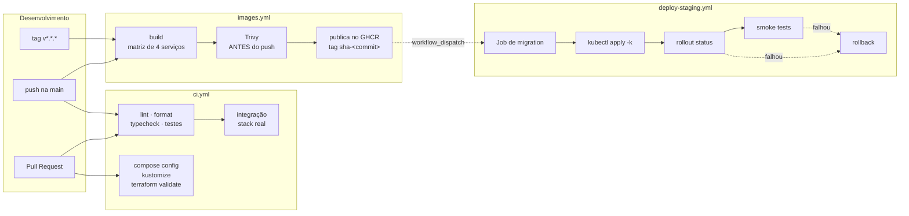
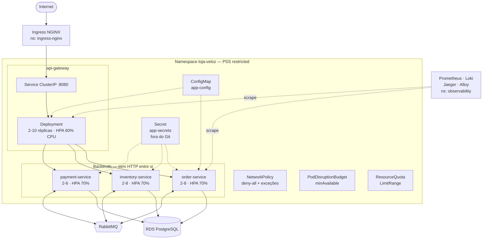
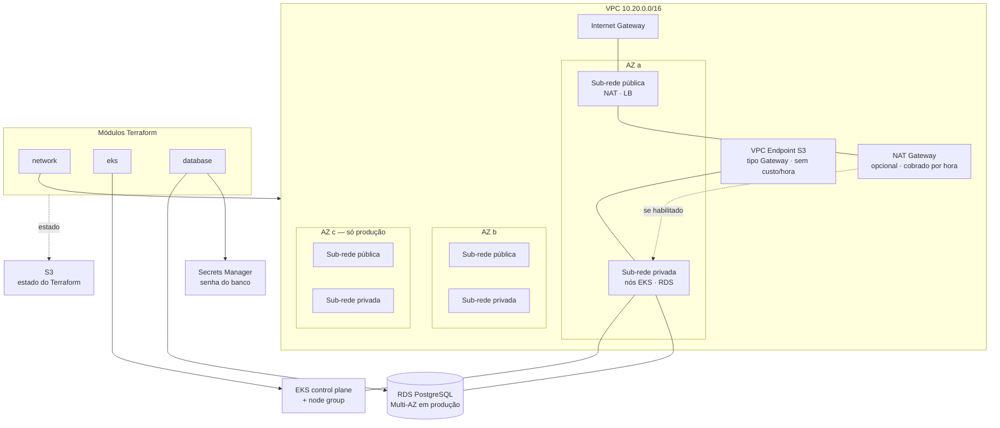

# Diagramas

Todos os diagramas são **Mermaid em texto**, versionados junto do código. Nada
de imagem binária: um PNG exportado de ferramenta externa fica desatualizado no
primeiro refactor e ninguém percebe.

O GitHub renderiza Mermaid nativamente em arquivos Markdown.

## Onde está cada um

| # | Diagrama | Tipo | Arquivo |
|---|---|---|---|
| 1 | Arquitetura geral | `graph TB` | [`architecture.md` §2](../architecture.md) |
| 2 | Fluxo de criação do pedido | `sequenceDiagram` | [`architecture.md` §4](../architecture.md) |
| 3 | Estados do pedido | `stateDiagram-v2` | [`architecture.md` §5](../architecture.md) |
| 4 | Topologia RabbitMQ | `graph LR` | [`architecture.md` §6](../architecture.md) |
| 5 | Modelo de dados | `erDiagram` | [`architecture.md` §7](../architecture.md) |
| 6 | Observabilidade | `graph LR` | [`architecture.md` §8](../architecture.md) |
| 7 | Pipeline CI/CD | `graph LR` | abaixo |
| 8 | Kubernetes | `graph TB` | abaixo |
| 9 | AWS com Terraform | `graph TB` | abaixo |

---

## 7. Pipeline CI/CD

O Trivy roda **antes** do push, sobre a imagem carregada no daemon local.
Escanear depois significaria já ter distribuído uma imagem vulnerável.

O rollback automático só ocorre quando `skip_migrations` é verdadeiro:
reverter Deployment não desfaz migration, e colocar código antigo contra
schema novo pode ser pior que o estado atual.

---

## 8. Kubernetes

Cada serviço tem ServiceAccount própria, com
`automountServiceAccountToken: false`: nenhum deles fala com a API do
Kubernetes, então montar a credencial só ampliaria o estrago de um
comprometimento.

---

## 9. AWS com Terraform

**RabbitMQ não é provisionado por este Terraform.** As opções corretas são
Amazon MQ ou o RabbitMQ Cluster Operator; entregar um `aws_mq_broker` nunca
aplicado seria preencher diretório sem validação. Registrado em
`docs/limitations-and-roadmap.md`.

---

## Cuidados com o Mermaid do GitHub

O renderizador do GitHub é mais restritivo que o playground do Mermaid. O que
foi evitado nestes diagramas:

- parênteses, colchetes e chaves **dentro** de rótulos sem aspas — quebram o
  parser
- acentos em identificadores de nó (só no texto entre aspas)
- ` ` é aceito; `\n` não
- `subgraph` sem identificador antes do rótulo
- comentários `%%` no meio de uma definição de aresta

Ao alterar um diagrama, confira a renderização na própria página do GitHub
antes de considerar pronto: erro de sintaxe aparece como bloco de código cru,
não como mensagem de erro.
